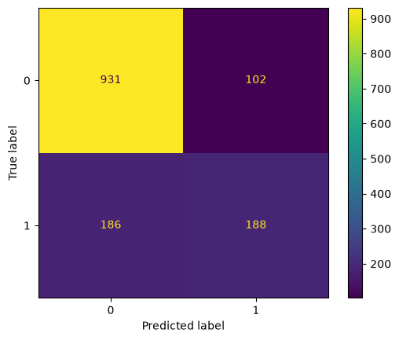
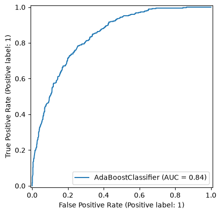
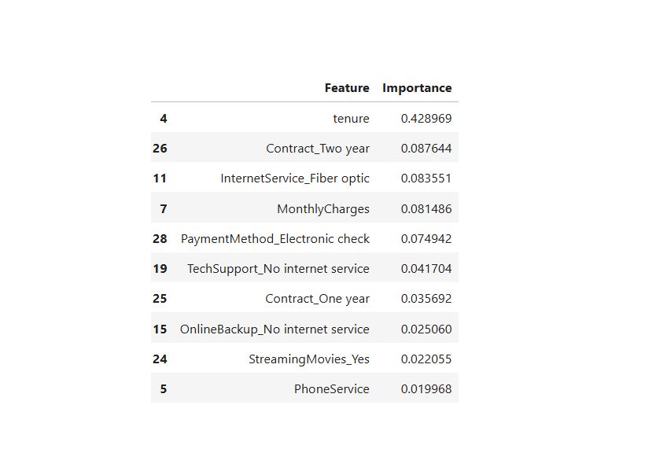

# 📉 Telco Customer Churn Prediction using Machine Learning

## 📌 Project Overview

Customer churn is one of the most significant challenges faced by telecommunication companies. Losing existing customers directly impacts revenue, making customer retention a key business objective.

This project develops and compares multiple **Supervised Machine Learning** models to predict whether a customer is likely to churn. By identifying customers at risk, businesses can implement targeted retention strategies, improve customer satisfaction, and reduce revenue loss.

---

# 🎯 Problem Statement

Telecommunication companies collect large amounts of customer data, but identifying customers who are likely to discontinue their services remains challenging.

The objective of this project is to build predictive machine learning models that can accurately identify potential churn customers and provide actionable business insights.

---

# 🎯 Objectives

* Analyze customer demographics and service usage.
* Perform data cleaning and preprocessing.
* Explore customer behavior through visualization.
* Train multiple supervised learning algorithms.
* Compare model performance using classification metrics.
* Select the best-performing model for churn prediction.
* Generate business recommendations to reduce customer churn.

---

# 📂 Dataset Information

The project uses the **Telco Customer Churn Dataset**.

### Dataset Features

| Category              | Examples                                            |
| --------------------- | --------------------------------------------------- |
| Customer Information  | Gender, Senior Citizen, Partner, Dependents         |
| Service Details       | Phone Service, Internet Service, Streaming Services |
| Account Information   | Contract Type, Payment Method, Paperless Billing    |
| Financial Information | Monthly Charges, Total Charges                      |
| Customer History      | Tenure                                              |
| Target Variable       | Churn (Yes / No)                                    |

---

# 🛠️ Technologies Used

### Programming Language

* Python

### Libraries

* Pandas
* NumPy
* Matplotlib
* Seaborn
* Scikit-learn
* XGBoost
* Joblib

---

# 🔄 Project Workflow

```text
Business Problem
        ↓
Data Collection
        ↓
Data Cleaning
        ↓
Exploratory Data Analysis (EDA)
        ↓
Feature Engineering
        ↓
Encoding & Feature Scaling
        ↓
Train-Test Split
        ↓
Model Training
        ↓
Model Evaluation
        ↓
Model Comparison
        ↓
Business Insights
```

---

# 🧹 Data Preprocessing

The following preprocessing steps were performed:

* Missing value analysis
* Duplicate record removal
* Data type conversion
* Handling blank values
* Label Encoding
* One-Hot Encoding
* Feature Scaling using StandardScaler

---

# 📊 Exploratory Data Analysis

EDA was performed to understand customer behavior and identify factors contributing to churn.

Analysis included:

* Customer churn distribution
* Gender analysis
* Contract type analysis
* Monthly charges distribution
* Tenure analysis
* Correlation analysis

### Sample Visualizations

* Customer Churn Distribution
* Correlation Heatmap
* Monthly Charges Distribution
* Tenure Distribution
* Contract Type Analysis

---

# 🤖 Machine Learning Models

The following supervised learning algorithms were implemented and evaluated:

* Logistic Regression
* K-Nearest Neighbors (KNN)
* Decision Tree Classifier
* Random Forest Classifier (Tuned)
* Naive Bayes
* AdaBoost Classifier
* Gradient Boosting Classifier
* XGBoost Classifier

---

# 📈 Model Evaluation

Models were evaluated using:

* Accuracy
* Precision
* Recall
* F1 Score
* ROC-AUC Score
* Confusion Matrix

---

# 📊 Model Comparison

| Model                     |  Accuracy  |  Precision |   Recall   |  F1 Score  |   ROC-AUC  |
| ------------------------- | :--------: | :--------: | :--------: | :--------: | :--------: |
| **AdaBoost**              | **79.53%** | **64.83%** |   50.27%   |   56.63%   | **84.08%** |
| **Gradient Boosting**     | **79.53%** |   63.78%   |   53.21%   | **58.02%** |   84.07%   |
| **Random Forest (Tuned)** |   79.46%   | **64.91%** |   49.47%   |   56.15%   |   83.60%   |
| Decision Tree             |   77.83%   |   58.07%   | **59.63%** |   58.84%   |   81.97%   |
| Logistic Regression       |   78.68%   |   62.17%   |   50.53%   |   55.75%   |   81.42%   |
| K-Nearest Neighbors       |   78.68%   |   62.17%   |   50.53%   |   55.75%   |   81.42%   |
| XGBoost                   |   77.11%   |   57.60%   |   52.67%   |   55.03%   |   81.14%   |
| Naive Bayes               |   64.46%   |   41.84%   | **86.36%** |   56.37%   |   81.02%   |

---

# 🏆 Best Performing Model

Based on the evaluation metrics:

**AdaBoost Classifier** achieved the highest overall performance.

### Performance

* **Accuracy:** 79.53%
* **Precision:** 64.83%
* **Recall:** 50.27%
* **F1 Score:** 56.63%
* **ROC-AUC:** 84.08%

Gradient Boosting also demonstrated competitive performance with the highest F1 Score, making it a strong alternative depending on business requirements.

---

## 📊 Confusion Matrix

The confusion matrix shows the model's classification performance by comparing actual and predicted customer churn.



---

## 📈 ROC Curve

The ROC Curve evaluates the model's ability to distinguish between churn and non-churn customers across different classification thresholds.



---

## ⭐ Feature Importance

Feature importance highlights the variables that have the greatest influence on predicting customer churn.



---

# 📌 Project Results

The developed machine learning models successfully predicted customer churn using historical customer data.

Key outcomes:

* Compared **8 supervised machine learning algorithms**.
* Identified AdaBoost as the best overall performing model.
* Evaluated models using multiple classification metrics.
* Generated business recommendations for customer retention.
* Demonstrated an end-to-end machine learning workflow from data preprocessing to model evaluation.

---

# 💡 Business Insights

The analysis revealed that customers are more likely to churn when they:

* Have month-to-month contracts.
* Have shorter tenure.
* Pay higher monthly charges.
* Lack value-added services such as Online Security and Tech Support.

### Business Recommendations

* Encourage long-term contracts through discounts.
* Improve customer onboarding.
* Provide personalized retention campaigns.
* Offer loyalty rewards to long-term customers.
* Promote additional service packages to increase customer engagement.

---

# 📚 Learning Outcomes

This project strengthened practical knowledge in:

* Data Cleaning
* Feature Engineering
* Exploratory Data Analysis
* Classification Algorithms
* Model Evaluation
* Feature Scaling
* Hyperparameter Tuning
* Ensemble Learning
* Business Analytics
* Customer Churn Prediction

---

# 📁 Project Structure

```text
Telco-Customer-Churn-Prediction
│
├── Dataset
│   └── Telco-Customer-Churn.csv
│
├── Notebook
│   └── Telco_Customer_Churn_Prediction.ipynb
│
├── Images
│   ├── churn_distribution.png
│   ├── correlation_heatmap.png
│   ├── confusion_matrix.png
│   ├── roc_curve.png
│   └── feature_importance.png
│
├── Models
│   └── best_model.pkl
│
├── README.md
│
└── requirements.txt
```

---

# 🚀 Future Improvements

* Perform advanced hyperparameter tuning.
* Handle class imbalance using SMOTE.
* Deploy the model using Streamlit.
* Build a Power BI dashboard for business users.
* Integrate the model into a REST API for real-time predictions.

---

# 👨‍💻 Author

**Anuj Bhatt**

GitHub: https://github.com/anujbhatt30

Aspiring Machine Learning Enthusiast Thank you
---

# ⭐ Support

If you found this project helpful, consider giving it a ⭐ on GitHub.

Thank you!